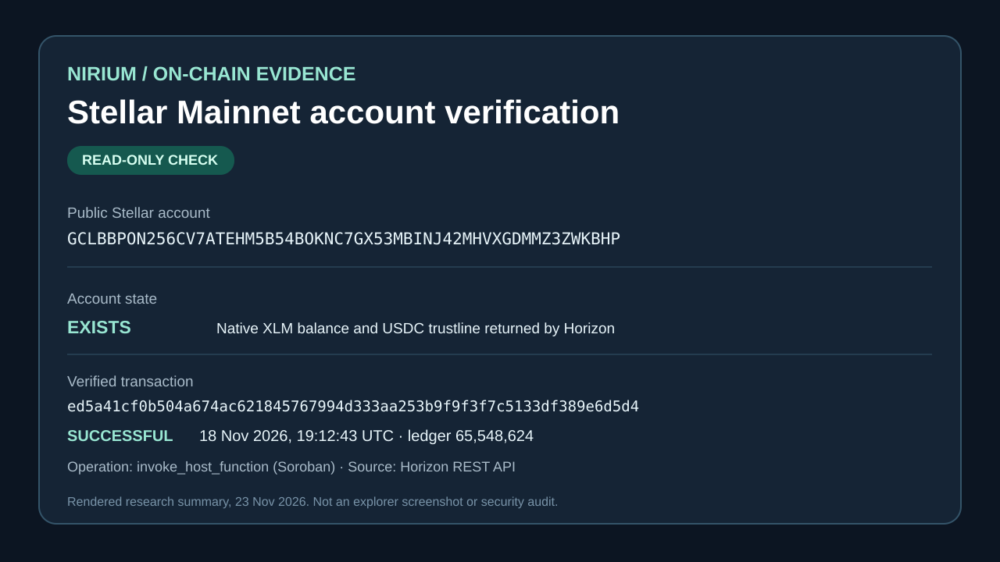

# Nirium — Stellar Wave Hub research for Issue #335

Research date: **23 November 2026**. Contributor: **[@Peaostrel](https://github.com/Peaostrel)**. Source revision: [nirium-protocol/nirium@c0d535d2943d](https://github.com/nirium-protocol/nirium/tree/c0d535d2943d7d1eccbfd2eb9e18832d7273b06a).

**Status:** Research and public on-chain checks completed. **Not yet uploaded to the Hub** because authenticated Hub sign-in and actual screenshot upload are still required. A PR or this research file does **not** count as a completed Hub submission.

## Hub submission fields

| Field | Value |
| --- | --- |
| Name | Nirium |
| Category | Infrastructure |
| Stellar network | mainnet |
| Verified Stellar account | `GCLBBPON256CV7ATEHM5B54BOKNC7GX53MBINJ42MHVXGDMMZ3ZWKBHP` |
| Stellar contract ID for this entry | Not supplied: Nirium's own vault is testnet-only, and the mainnet DeFindex vault is third-party |
| Website | https://nirium.xyz |
| GitHub source and SDK | https://github.com/nirium-protocol/nirium |
| Contract/source monorepo | https://github.com/nirium-protocol/nirium-core |
| Tags | stellar, x402, soroban, agent-payments, developer-tools, audit-trail, ipfs, treasury, sdk |

## Original project description (431 words)

Nirium is a set of open-source developer tools for making payments and recording verifiable evidence in applications built around the Stellar network. It focuses on two problems that are easy to confuse. First, autonomous agents need to pay for APIs or services without receiving unlimited authority over their operator’s wallet. Second, businesses need to preserve evidence of what was authorized or declared, including actions that never became blockchain transactions. Stellar can verify a transfer, but a transfer by itself does not prove why an agent made it or whether someone refused a request.

For payments, Nirium’s TypeScript and Python SDKs expose x402 integration for paid HTTP endpoints and clients. The SDKs include configurable spending limits, with a conservative default for agent-initiated USDC purchases, and an experimental policy callback that can deny or defer a signature. Settlement uses Stellar transfers and an external x402 facilitator. That means the public ledger is the source of truth for a completed payment, while the policy decision remains an off-chain concern. A hosted development API and CLI provide examples, and the public documentation links transactions and explicit verification instructions.

For evidence, Nirium produces tamper-evident Audit Trail receipts. An application hashes a statement or result, can sign it with its own Stellar key, and stores the receipt content through IPFS. Independent verification can compare the CID, hash and signature. This can show that a particular signer declared a particular record and that the record has not changed. It does not establish that the underlying statement was true, and an IPFS receipt should not be represented as a Stellar ledger record. The design also allows a refused payment or an approval decision to leave verifiable evidence even when there is no transaction hash.

Nirium’s treasury experiments use Soroban differently. Its own NiriumVault contract is a testnet prototype that the project explicitly says has not completed an independent audit. The separate mainnet treasury demonstration instead interacts with a client-owned DeFindex vault through a restricted RebalanceManager role. Its operation is invite-only, and its documentation states that broader access awaits legal review. Those distinctions matter: it would be misleading to describe the testnet contract as production-ready or to treat controlled integration tests as organic customer adoption.

The open-source repositories include SDKs, a CLI, an MCP server, contract code, automated checks, and independently inspectable evidence. Public GitHub activity shows multiple contributors and two named code maintainers, but it does not by itself establish an incorporated company or independent security approval. Nirium fits the Infrastructure category because it provides reusable payment and evidence rails to other applications rather than being a consumer wallet.

## Problem and Stellar integration

Nirium addresses delegated API payments and signed explanations of off-chain decisions. A Stellar payment is verifiable on the ledger, while a signed Audit Trail record can explain the associated decision without exposing private data. The x402 tools build and settle Stellar payments via external facilitators. Soroban is also used for experimental treasury logic. The mainnet treasury deployment uses a **third-party DeFindex contract**; NiriumVault itself is **testnet-only** and unaudited.

Technical approach: TypeScript/Python SDKs, x402 HTTP middleware and clients, optional pre-sign policies, SHA-256/IPFS receipt content with optional Stellar-key signatures, command-line verification, read-only reporting, and separately permissioned treasury operations. See the [SDK and evidence documentation](https://github.com/nirium-protocol/nirium/blob/c0d535d2943d7d1eccbfd2eb9e18832d7273b06a/README.md) and [technical core README](https://github.com/nirium-protocol/nirium-core/blob/f66c806033840761bc0e1a482f59dd3e56f5ee36/README.md).

## Eligibility for Stellar Wave

The official project repository [Issue #382](https://github.com/nirium-protocol/nirium/issues/382) has the **Stellar Wave** label and a [Drips Wave bot acceptance comment](https://github.com/nirium-protocol/nirium/issues/382). This is evidence that Nirium participated in Wave 11, not a claim that a separate contributor's issue is already complete.

## Duplicate review

Checked the live, paginated public Hub API on **23 November 2026**: [approved public projects, page 1](https://usestellarwavehub.vercel.app/api/projects?limit=50&page=1) reported **36 total, 1 page**. None matched the name **Nirium** or either of the two official repositories. Searched the Hub repository's existing research files and GitHub PR text for Nirium; no match was found.

**Limit:** the public API exposes approved/featured cards, not the private queue of pending submissions. Only authenticated Hub review can rule out a private pending duplicate. A lack of public matches is *not* proof that no private submission exists.

## Independent Stellar Mainnet verification

This is a **read-only check against Stellar Horizon**, not merely a copied address from the Nirium README.

| Evidence | Observed result | Link |
| --- | --- | --- |
| Public payment-receipt account | Stellar **mainnet account exists**, with active USDC trustline and native XLM balance | [Horizon account](https://horizon.stellar.org/accounts/GCLBBPON256CV7ATEHM5B54BOKNC7GX53MBINJ42MHVXGDMMZ3ZWKBHP) |
| Mainnet transaction | `ed5a41cf0b504a674ac621845767994d333aa253b9f9f3f7c5133df389e6d5d4`, `successful: true`, ledger **65,548,624**, time **2026-11-18T19:12:43Z** | [Horizon transaction](https://horizon.stellar.org/transactions/ed5a41cf0b504a674ac621845767994d333aa253b9f9f3f7c5133df389e6d5d4) |
| Operation in the transaction | One successful `invoke_host_function` operation (Soroban invocation) | [Horizon operations](https://horizon.stellar.org/transactions/ed5a41cf0b504a674ac621845767994d333aa253b9f9f3f7c5133df389e6d5d4/operations?limit=10) |
| Stated account ownership | Project's [evidence index](https://github.com/nirium-protocol/nirium/blob/c0d535d2943d7d1eccbfd2eb9e18832d7273b06a/EVIDENCE.md) identifies the account as the x402 billing/receiving account | [Official project evidence](https://github.com/nirium-protocol/nirium/blob/c0d535d2943d7d1eccbfd2eb9e18832d7273b06a/EVIDENCE.md) |

These observations establish existence of the specified public account and successful transaction on Mainnet, with the association to Nirium documented in its own evidence list. They do **not** by themselves establish a paying-customer count, independently audited contracts, transaction purpose, or source-to-deployed-WASM equivalence. The team explicitly says its recorded payments include self-tests and partner integration tests.

A reproducible summary is saved in [`onchain-verification.json`](./onchain-verification.json). Its accompanying [rendered evidence image](./mainnet-evidence.svg) is **a visualization derived from the saved Horizon response, not an unedited screenshot of Horizon or Stellar Expert**.

## Team and community

Project documentation names **[@Eras256](https://github.com/Eras256)** and **[@M0nsxx](https://github.com/M0nsxx)** as code maintainers and records outside partner tests and contributions, including a partner relationship with AgentLedger. The founder of AgentLedger works on Nirium part time, which is an important independence caveat when interpreting the project's own reported payment tests. See [reviewer notes](https://github.com/nirium-protocol/nirium/blob/c0d535d2943d7d1eccbfd2eb9e18832d7273b06a/docs/FOR-REVIEWERS.md), [evidence limits](https://github.com/nirium-protocol/nirium/blob/c0d535d2943d7d1eccbfd2eb9e18832d7273b06a/EVIDENCE.md), and [design FAQ](https://github.com/nirium-protocol/nirium/blob/c0d535d2943d7d1eccbfd2eb9e18832d7273b06a/docs/DESIGN-FAQ.md). No inference about a legal corporate entity is made.

## Supporting visuals

- 
- [Nirium's project-maintained integration architecture diagram](https://raw.githubusercontent.com/nirium-protocol/nirium-core/f66c806033840761bc0e1a482f59dd3e56f5ee36/apps/web/public/nirium-integracion-eng.png) (official repo image; architectural context, **not** independent evidence of deployment)
- [Live Nirium product](https://nirium.xyz) and [live statistics page](https://nirium.xyz/stats) (source pages for a product screenshot)
- [Stellar Expert Mainnet account](https://stellar.expert/explorer/public/account/GCLBBPON256CV7ATEHM5B54BOKNC7GX53MBINJ42MHVXGDMMZ3ZWKBHP) (source page for an independent explorer screenshot)

**Before uploading:** capture a current product UI screenshot and a live explorer page, or download the provided research visualization and the official integration architecture image. The Hub submission form requires **at least one actual image file uploaded**. The image files have not been authenticated-uploaded to the Hub from this PR.

## Limitations and risks

- NiriumVault is testnet-only, audit-gated, and not in charge of real production customer funds.
- Mainnet treasury is invite-only, depends on a third-party DeFindex vault and is legally gated.
- IPFS Audit Trail entries are not themselves transactions on Stellar, and receipt verification does not prove the record's truth.
- The project's reported x402 activity includes its own and integration partners' test transfers, not evidence of organic revenue.
- Mainnet account verification is not an independent compliance audit or an endorsement.

## Source register

1. [Nirium core source at `f66c80603384`](https://github.com/nirium-protocol/nirium-core/tree/f66c806033840761bc0e1a482f59dd3e56f5ee36)
2. [Nirium SDK, CLI, Wave repo at `c0d535d2943d`](https://github.com/nirium-protocol/nirium/tree/c0d535d2943d7d1eccbfd2eb9e18832d7273b06a)
3. [Nirium EVIDENCE.md (dated 22 Nov 2026)](https://github.com/nirium-protocol/nirium/blob/c0d535d2943d7d1eccbfd2eb9e18832d7273b06a/EVIDENCE.md)
4. [10-minute reviewer guide](https://github.com/nirium-protocol/nirium/blob/c0d535d2943d7d1eccbfd2eb9e18832d7273b06a/docs/FOR-REVIEWERS.md)
5. [Nirium Wave 11 Issue #382](https://github.com/nirium-protocol/nirium/issues/382)
6. [Public Hub directory API](https://usestellarwavehub.vercel.app/api/projects?limit=50&page=1)
7. [Mainnet Horizon account](https://horizon.stellar.org/accounts/GCLBBPON256CV7ATEHM5B54BOKNC7GX53MBINJ42MHVXGDMMZ3ZWKBHP)
8. [Mainnet Horizon transaction](https://horizon.stellar.org/transactions/ed5a41cf0b504a674ac621845767994d333aa253b9f9f3f7c5133df389e6d5d4)
9. [Mainnet Horizon operation](https://horizon.stellar.org/transactions/ed5a41cf0b504a674ac621845767994d333aa253b9f9f3f7c5133df389e6d5d4/operations?limit=10)

## Remaining submission action

Open [Submit a Project](https://usestellarwavehub.vercel.app/submit), sign in, verify no pending Nirium entry, paste the fields from [`submission-draft.json`](./submission-draft.json), add its two labeled GitHub repository links, upload at least one current research screenshot/image, then submit. Save the resulting project ID or confirmation URL in this document. **Until that happens, Issue #335 is only partially satisfied.**
